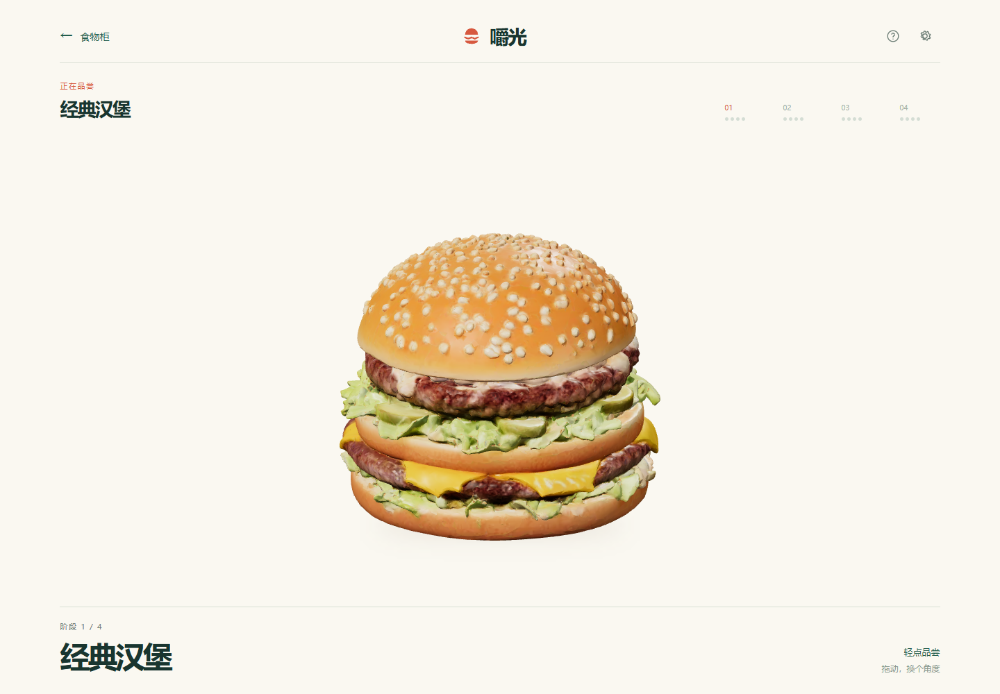

# 食刻 · FoodStage 3D

**把喜欢的食物，转着看，一口口吃掉。**

一个面向手机浏览器的 3D 食物互动小游戏。轻点进食，拖动观察，用声音、形变和食物逐渐减少的变化，做一段短暂的解压体验。



## 现在能玩什么

- 经典汉堡：4 个食用阶段，共 16 口。
- 点击进食、拖动旋转，吃完可重玩或回到食物柜。
- 咀嚼声音、碎屑反馈，以及声音和动态效果设置。
- 支持手机与桌面浏览器。

**当前是可玩的原型，尚未发布在线试玩地址。** 下一步先完成公开试玩与真机体验验证，再扩充食物。

## 本地运行

需要 Node.js 22.12+、pnpm。

```sh
pnpm install
pnpm dev
```

打开终端显示的地址。`pnpm build` 构建，`pnpm preview` 预览；`pnpm test` 运行单测，`pnpm test:browser` 运行浏览器测试。

技术栈：React · TypeScript · Three.js / React Three Fiber · Vite。

## 一起推进

- [下一阶段路线](docs/roadmap.md)：先做好试玩、食物质感和第二款内容。
- [提供新食物](docs/adding-food.md)：准备同一种食物的 4 个带贴图 GLB、名称与阶段顺序。
- [模型优化](docs/model-optimization.md)：模型压缩与手机资源预算。

欢迎通过 [Issues](https://github.com/Fuya0/foodstage-3d/issues) 反馈，附设备、浏览器和录屏最有帮助。
